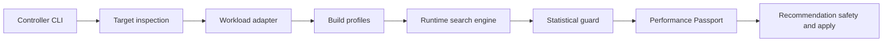

# PerfRunbench

PerfRunbench is a reproducible AI benchmarking and autotuning toolkit. Its
current release focus is **ArmTune**, an Arm AI inference subsystem for:

- Arm platform inspection
- Reproducible AI benchmarking
- Build and runtime configuration search
- Statistical confirmation
- Performance Passport generation
- Guarded recommendation show, validate, dry-run apply, canary, lease, and
  rollback

ArmTune is the Arm-focused counterpart to the generic PerfRunbench resource and
recommendation infrastructure. `llama.cpp` is the first workload adapter, not
the product identity.

## Primary Workflow

The shortest public workflow for a new user is:

```bash
python -m pip install .
autotuneai init --adapter pytorch-training --output autotune.yaml
autotuneai doctor --config autotune.yaml -- python train.py
autotuneai run --auto --config autotune.yaml -- python train.py
```

`init` writes a public placeholder config for the selected adapter. `doctor`
performs non-destructive readiness checks without launching the workload,
tuning candidates, applying recommendations, or changing system settings. `run
--auto` fingerprints the command and environment, checks the local
RecommendationCache, retunes when policy requires it, validates/canaries the
selected process-scoped recommendation, launches the full workload, and cleans
up the apply lease. Use `autotuneai tune` when you want to tune and cache a
recommendation without launching the long workload afterward.

The `pytorch-training` adapter tunes bounded training slices with allowlisted
knob bindings. It does not require PyTorch as a core dependency and does not
rewrite user source files.

The default ArmTune flow is:

```text
inspect Arm target
-> inspect workload runtime
-> benchmark portable baseline
-> build Arm profiles
-> search runtime candidates
-> confirm selected candidate
-> generate Performance Passport
-> show, validate, and guarded-apply the recommendation
```



Production Arm performance claims require a real Linux Arm64 target. Fixture,
synthetic, and CI-runner outputs are labeled separately and are not measured
Arm performance.

## Install

PerfRunbench is not published to PyPI in this repository state. Install from a
source checkout or a locally built wheel:

```bash
python -m pip install .
```

Local wheel flow:

```bash
python -m pip install build
python -m build
python -m pip install dist/perfrunbench-<version>-py3-none-any.whl
```

Development environment:

```bash
conda env create -f environment.yml
conda activate autotuneai
python -m pip install -e .
python scripts/run_tests.py --fast
```

`environment.yml` is intentionally small. Use
`python -m pip install -e ".[benchmark]"` or `environment-benchmark.yml` for
PyTorch, ONNX, and GPU benchmark examples.

## ArmTune Quick Start

Public examples are placeholders. Keep real hostnames, identity files, model
paths, and private target configs outside git.

Inspect the controller and an Arm SSH target:

```bash
autotuneai arm doctor \
  --target-config configs/armtune/target_ssh.example.json \
  --require-production

autotuneai arm inspect-host \
  --target-config configs/armtune/target_ssh.example.json
```

Run a fixed `llama-bench` baseline:

```bash
autotuneai arm benchmark \
  --config configs/armtune/llama_bench.example.json
```

Generate and inspect Arm build-profile evidence:

```bash
autotuneai arm build-plan \
  --config configs/armtune/build_profiles.example.json

autotuneai arm build-profile \
  --config configs/armtune/build_profiles.example.json
```

Run bounded runtime optimization:

```bash
autotuneai arm optimize \
  --config configs/armtune/llama_bench_optimize.example.json \
  --max-candidates 12 \
  --affinity-modes scheduler-default,compact,spread,reserve-one-core
```

Compare profiles and generate a Passport:

```bash
autotuneai arm profile-compare \
  --config configs/armtune/profile_comparison.example.json

autotuneai arm passport \
  --comparison-result .autotuneai/runs/<run_id>/armtune/profile_comparison/profile_comparison_result.json

autotuneai arm verify-passport \
  --passport .autotuneai/runs/<run_id>/armtune/passport/performance_passport.json
```

Show, validate, and dry-run a guarded recommendation:

```bash
autotuneai recommendation show \
  --bundle .autotuneai/recommendations/<bundle_id>.json

autotuneai recommendation validate \
  --bundle .autotuneai/recommendations/<bundle_id>.json

autotuneai recommendation apply \
  --bundle .autotuneai/recommendations/<bundle_id>.json \
  --scope process \
  --dry-run
```

For a canary apply with rollback support:

```bash
autotuneai recommendation apply \
  --bundle .autotuneai/recommendations/<bundle_id>.json \
  --scope process \
  --lease-minutes 30 \
  --canary-runs 1

autotuneai recommendation status \
  --bundle .autotuneai/recommendations/<bundle_id>.json

autotuneai recommendation rollback \
  --bundle .autotuneai/recommendations/<bundle_id>.json
```

## Real Arm Evidence Snapshot

The current measured Arm evidence is a preliminary single-target result on a
user-provisioned Linux Arm64 C7g / Neoverse-V1 target using Qwen2.5-7B Q4_K_M
and a pinned llama.cpp source commit. It is not a global optimum and not a
cross-platform claim.

`llama-bench` build-profile comparison, fixed protocol:

| profile | decode median |
| --- | ---: |
| `portable-baseline` | `10.825 tok/s` |
| `arm-native` | `17.530 tok/s` |
| `arm-optimized` | `17.380 tok/s` |

`llama-bench` bounded runtime search, separate protocol:

| item | decode median |
| --- | ---: |
| search baseline | `13.630 tok/s` |
| selected candidate | `17.480 tok/s` |
| observed runtime-search improvement | `28.246515%` |

`llama-server` secondary latency evidence, separate protocol:

| profile | TTFT median |
| --- | ---: |
| `portable-baseline` | `97.260 ms` |
| `arm-native` | `62.826 ms` |

Performance Passport status:

```text
claim_eligibility_state: eligible_preliminary
verification_status: passed
guarded_apply_validation: passed
```

guarded apply validation passed.

These protocol-specific results must not be combined into a single aggregate
speedup. The supported wording is:

> Best observed eligible configuration under the tested Arm target, model,
> inference workload, and measurement protocol.

Detailed evidence is recorded in:

```text
docs/armtune/results/PHASE_9_FIRST_REAL_ARM_TUNING.md
docs/armtune/results/PHASE_10_GUARDED_APPLY_VALIDATION.md
```

## Related Historical Experiment

BootTraceBench is maintained separately at
`https://github.com/xuwwwww/BootTraceBench` as an experimental firmware-log
model evaluation project. It is not part of PerfRunbench tuning or
recommendation eligibility. The `v0.1.0-armtune` tag preserves the former
integrated BootTrace state for historical review.

## Generic PerfRunbench Workflows

The repository also includes generic PerfRunbench resource-guard and workload
tuning commands:

```bash
autotuneai inspect
autotuneai executors --probe-systemd --probe-docker --check-sudo-cache
autotuneai doctor --config autotune.yaml -- python train.py
autotuneai run --auto --config autotune.yaml -- python train.py
autotuneai tune --config configs/examples/tune_command.yaml -- <command that writes metrics.json>
autotuneai run --best --config configs/examples/run_command.yaml -- <command that matches the cached identity>
autotuneai cache list
autotuneai run -- python examples/dummy_train.py
autotuneai tune-system
autotuneai tune-runtime --profile runtime-pytorch-max-performance
autotuneai optimize -- python examples/gpu_training_pressure.py --config examples/gpu_training_pressure_config.yaml
autotuneai report-comparison --input results/reports/tuning_comparison.json
```

Use `autotuneai restore --active` if an interrupted run left reversible
runtime tuning state in `.autotuneai/active_tuning_state.json`.

## Development Validation

Fast validation:

```bash
python scripts/run_tests.py --fast
```

Focused ArmTune validation:

```bash
python -m unittest discover -s tests -p "test_arm_tune*.py" -v
```

Compile check:

```bash
python -m compileall autotune
```

The public test suite does not require Arm hardware, SSH access, model files,
root privileges, cloud credentials, or network access.

## Repository Layout

```text
autotune/
  golden_path/    Command identity, metric-source parsing, bounded tuning,
                  recommendation cache lookup, and automatic reuse policy.
  training_adapter/
                  PyTorch training adapter config validation, safe knob
                  bindings, bounded slices, effective-batch guards, and
                  training metric parsing.
  training_metrics.py
                  Dependency-free helper for structured training progress and
                  result records.
  arm_tune/       Arm target inspection, llama.cpp adapter, search, profiles,
                  Passport, and workload-neutral correctness hooks.
  recommendation/ Generic RecommendationBundle generation, validation, guarded
                  apply, canary, lease, promote, and rollback.
  resource/       Run directories, process execution, monitoring, CPU affinity,
                  resource budgets, and lifecycle cleanup.
  report/         Markdown and HTML report helpers.
  runtime_tuner/  Process-level runtime environment profiles.
  system_tuner/   Reversible host tuning profiles.
configs/          Public placeholder configs and benchmark examples.
docs/armtune/     Architecture, methodology, evidence, limitations, Devpost,
                  and demo packaging.
tests/            Unit, fixture, and fake integration tests.
```

## Current Status

PerfRunbench ArmTune has a measured preliminary Arm build/runtime tuning result,
a verified eligible preliminary Performance Passport, and a real guarded
process-scoped apply validation. Release limitations are documented in
`docs/armtune/LIMITATIONS.md`.
