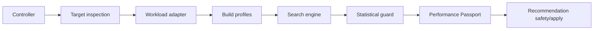

# ArmTune Architecture

## Product Identity

ArmTune is an Arm-first AI inference optimization subsystem inside
PerfRunbench. It is not generic Arm compatibility, a generic benchmark wrapper,
or a dashboard around llama.cpp.

## Controller and Target

ArmTune splits orchestration from measurement:

- Controller: user-facing CLI, configuration validation, search orchestration,
  comparison, passport/report generation, and fixture-based tests.
- Target: real Linux Arm64 host inspection, build inspection, inference
  execution, CPU placement, process monitoring, optional profiling, and raw
  artifact generation.

The controller may run on x86_64 or Arm64. Production benchmarks must run on a
real Linux Arm64 target.

## Target Protocol

The target abstraction should conceptually support:

```text
inspect()
prepare_run()
upload_file()
upload_directory()
execute()
start_process()
terminate_process()
download_file()
download_directory()
collect_artifacts()
cleanup()
```

The remote protocol should avoid arbitrary shell command construction:

Controller responsibilities:

1. Validate configuration.
2. Create a versioned JSON job specification.
3. Upload only required files.
4. Invoke a fixed remote ArmTune worker command.
5. Download versioned result manifests and artifacts.
6. Validate schemas and artifact digests.

Remote worker responsibilities:

1. Receive only a job-spec path and run directory.
2. Validate every field.
3. Execute an allowlisted operation.
4. Write versioned structured results.
5. Preserve raw stdout/stderr.
6. Perform cleanup.

The initial SSH implementation must use the system OpenSSH client with strict
host-key checking by default. It must not use `shell=True`, must not be built
around arbitrary remote shell strings, and must not add Paramiko unless the
system OpenSSH approach has a documented blocker.

The SSH worker command is structured configuration, not a free-form remote
command string. The MVP fields are:

- `remote_python`
- `remote_module`
- `remote_workdir`

The fixed worker invocation shape is:

```text
python3 -m autotune.cli arm worker --job-spec <path> --run-dir <path>
```

The controller may configure a different Python executable or module path, but
it must still invoke the same argument shape. ArmTune must not accept an
arbitrary `remote_worker_command` field.

Before production benchmark commands, the SSH target must verify:

- Python executable availability.
- Module import availability.
- Worker protocol compatibility.
- Linux operating system.
- Arm64 architecture.
- Writable remote work directory.

## Package Layout

Initial target:

```text
autotune/
  arm_tune/
    __init__.py
    cli.py
    config.py
    schemas.py
    errors.py
    targets/
      __init__.py
      base.py
      local.py
      ssh.py
      worker.py
      protocol.py
    platform/
      __init__.py
      architecture.py
      cpu_identity.py
      cpu_features.py
      topology.py
      cloud_platform.py
      environment.py
      evidence.py
```

Later packages:

```text
builds/
adapters/
benchmark/
search/
quality/
profiling/
passport/
ci/
report/
```

Phase 3B.1 introduces a narrow runtime adapter boundary:

```text
autotune/arm_tune/adapters/
  base.py
  llama_bench.py
  llama_server.py
```

The adapter boundary is intentionally thin in Phase 3B.1. Existing
`llama-bench` execution and search code remains backward compatible, while the
new `llama-server` vertical slice uses a separate worker operation and artifact
layout.

## PerfRunbench Reuse

Reuse existing PerfRunbench infrastructure where sound:

- `.autotuneai/runs/<run_id>/` lifecycle and provenance.
- Resource budgets and CPU affinity primitives.
- Systemd, Docker, and local executor capability ideas.
- Signal handling and cleanup patterns.
- Paired baseline and noise-band decision logic.
- Generic JSON and HTML report helpers.

The concrete symbol-level reuse map is maintained in `REUSE_MAP.md`.

ArmTune-specific artifacts live under:

```text
.autotuneai/runs/<run_id>/armtune/
```

## CLI Shape

The top-level CLI remains `autotuneai`. ArmTune adds one isolated group:

```text
autotuneai arm doctor
autotuneai arm inspect-host
autotuneai arm inspect-build
autotuneai arm benchmark
autotuneai arm optimize
autotuneai arm profile
autotuneai arm passport
autotuneai arm compare
autotuneai arm ci-check
autotuneai arm demo
```

`autotune/cli.py` should only receive a thin dispatcher for the `arm` group.

## Doctor Status Semantics

`autotuneai arm doctor` reports diagnostics, not benchmark success. It may
return exit code 0 when diagnostics complete successfully even if no production
Arm target is ready.

Doctor output separates:

- `controller_status`: whether the controller-side diagnostics completed.
- `local_target_status`: whether the controller machine itself is a supported
  local production target.
- `configured_target_status`: whether a supplied target configuration is ready.
- `production_benchmark_ready`: whether the configured target, or the local
  machine when no target config is supplied, is ready for real Linux Arm64
  production benchmark execution.

A Windows or x86_64 controller can have `controller_status: ready` while
`local_target_status: unsupported` and `production_benchmark_ready: false`.
Controller measurements must not be represented as Arm benchmark results.

## Serialization

Every serialized top-level ArmTune artifact includes:

- `schema_version`
- UTC timestamps
- stable enum values
- provenance sufficient to audit parsed metrics

Unknown future fields may be preserved where safe. Unknown critical
configuration fields should be rejected with actionable errors.

## Phase 2A Benchmark Slice

Phase 2A adds a minimal llama-bench vertical slice. It is a benchmark execution
path, not an optimization search and not a production performance claim.

The public command is:

```text
autotuneai arm benchmark --config <path>
```

The command creates a PerfRunbench run directory and stores ArmTune artifacts
under:

```text
.autotuneai/runs/<run_id>/armtune/benchmark/
```

The worker operation is allowlisted as:

```text
benchmark.llama_bench
```

The benchmark job models only explicit llama-bench fields: executable path and
optional expected hash, model path and optional expected hash, threads, prompt
tokens, generation tokens, repetitions, timeout, and a small allowlist of
additional supported options. It must not accept a generic command list or
`extra_command` field.

The worker validates the target architecture for measured results, validates
the binary and model, hashes both files with streaming SHA-256, inspects
`--version` and `--help`, checks required flags, executes one fixed invocation,
preserves raw stdout/stderr, parses metrics defensively, and writes versioned
JSON artifacts atomically.

Phase 2A artifact schema:

```text
benchmark_job.json
executable_manifest.json
model_manifest.json
inspection.json
invocation.json
parse_result.json
artifact_manifest.json
benchmark_result.json
raw/inspection_version_stdout.txt
raw/inspection_version_stderr.txt
raw/inspection_help_stdout.txt
raw/inspection_help_stderr.txt
raw/benchmark_stdout.txt
raw/benchmark_stderr.txt
trials/0001/trial_result.json
```

`benchmark_result.json` is the final top-level result and separates
`validation_status`, `execution_status`, `parse_status`, and
`benchmark_status`.

CLI exit codes:

```text
0 = benchmark completed and required metrics parsed
1 = execution completed but benchmark failed or required metrics missing
2 = invalid configuration, unsupported target, protocol mismatch, or validation failure
3 = internal/runtime error
```

Fixture runs must set `result_origin: test_fixture`. A real production
benchmark result must identify the target as Linux Arm64.

## Phase 2B Native Arm64 CI and Hardening

Phase 2B adds a GitHub-hosted native Arm64 smoke workflow. The workflow proves
that ArmTune can install, serialize host evidence, run focused tests, and
execute the fake llama-bench fixture path on `ubuntu-24.04-arm`.

The workflow does not prove inference optimization, real model performance,
KleidiAI usage, Arm optimized-path usage, or competition benchmark results. CI
wall-clock timing is not benchmark data and must not be published as
performance evidence.

Measured-origin rules:

- `test_fixture`: fake executable, parser fixture, simulated host identity, or
  CI smoke benchmark using a fake workload.
- `measured`: real Linux Arm64 target, real executable, real model, real
  benchmark execution, no test-only platform injection, and no fake executable
  marker.
- `unverified`: missing provenance, unsupported production target, or a result
  that cannot satisfy measured-origin criteria.

The job JSON `result_origin` field is treated as a requested origin, not as a
trusted fact. The worker writes `provenance` evidence explaining the selected
origin. Native Arm hardware alone cannot convert a fake benchmark into a
measured result.

Artifact trust boundary:

- The worker writes artifact records with relative paths and SHA-256 digests.
- The controller validates downloaded artifacts against
  `artifact_manifest.json` before reporting benchmark success.
- Missing artifacts, digest mismatches, duplicate manifest paths, traversal
  attempts, paths outside the run directory, and symlink escapes fail artifact
  validation.
- Suspicious artifacts are preserved for debugging; ArmTune does not delete
  them automatically.

Schema compatibility:

- Critical configuration and worker job fields reject unknown or invalid
  fields.
- `benchmark_result.json` may ignore unknown additive top-level fields during
  round-trip loading.
- Unsupported future `schema_version` values and missing `schema_version`
  fields are rejected.

Parser ambiguity policy:

- Multiple rows matching the same required metric produce
  `parse_status: ambiguous_output`.
- ArmTune returns all matched rows for audit but does not select the largest,
  fastest, or last value.
- `nan`, `inf`, negative throughput, malformed decimal values, and missing
  throughput are not converted to zero.

Phase 2C must use a real model and a real target before any preliminary
measured data is produced. Phase 2B only prepares skipped-by-default
real-Arm smoke scaffolding.

## Phase 3A Repeated Search Architecture

Phase 3A introduces `autotuneai arm optimize` as a performance-only search
command built on top of the Phase 2A/2B `benchmark.llama_bench` worker
operation. It does not introduce arbitrary remote shell commands and does not
add cloud instance control.

The controller owns search orchestration:

- load and validate the same benchmark target, executable, model, and token
  configuration used by `autotuneai arm benchmark`
- inspect the target once before search
- inspect the `llama-bench` binary help output before generating optional flags
- generate a small staged candidate set from visible target topology
- randomize candidate order with a recorded seed
- insert paired baseline trials at a configured cadence
- run repeated fixed worker jobs through the existing target abstraction
- aggregate distributions and classify results with a noise band
- write a versioned search result with `quality_gate_status: not_evaluated`

The target continues to execute only the allowlisted benchmark worker job. Each
search repetition is a normal benchmark job with a candidate-specific
configuration and its own raw artifacts. Failed repetitions are retained and
are not converted to zero-valued metrics.

Phase 3A artifact layout:

```text
.autotuneai/runs/<run_id>/armtune/optimize/
  optimize_config.json
  search_plan.json
  search_result.json
  candidates/<candidate_id>/...
  repetitions/<sequence_index>/
    benchmark_result.json
    artifact_manifest.json
    raw/...
```

Initial search stages:

1. thread count
2. threads-batch and batch parameters when supported by the inspected binary
3. affinity
4. confirmation of baseline and selected candidate

The search is intentionally staged and pruned. A full Cartesian product is not
the default behavior.

Recommendation semantics are conservative:

- recommendations are performance-only
- `quality_gate_status` is always `not_evaluated` in Phase 3A
- inconclusive candidates remain inconclusive within the configured noise band
- incompatible model, binary, target, token count, or protocol evidence prevents
  recommendation

## Phase 3B.1 llama-server Benchmark Foundation

Phase 3B.1 extends `autotuneai arm benchmark --config <path>` with a validated
runtime mode:

```json
{
  "runtime": {
    "adapter": "llama_server"
  },
  "workload": {
    "mode": "server"
  }
}
```

The worker operation is allowlisted as:

```text
benchmark.llama_server
```

The target owns server execution and request timing. The controller does not
send measured HTTP traffic from Windows or another non-target host. The worker
binds `llama-server` only to loopback, selects a free local port when
configured with `port: auto`, waits for readiness before measured requests,
preserves raw server stdout/stderr, records request stream artifacts, and
cleans up the process before returning.

Phase 3B.1 records:

- binary and model manifests
- raw `--version` and `--help` inspection output
- supported server flags detected from help output
- server configuration and selected loopback port
- lifecycle states for startup, readiness, cleanup, and port release
- warm-up and measured request artifacts
- streaming event logs
- generated output text
- TTFT and end-to-end latency from target-local client timestamps
- `quality_gate_status: not_evaluated`

Phase 3B.1 does not modify the Phase 3A search engine to use `llama-server`.
It does not perform workload-specific semantic scoring, KleidiAI verification,
build-profile comparison, Performix integration, Performance Passport
generation, cloud provisioning, or real AWS execution.

## Workload-Neutral Correctness Hooks

PerfRunbench keeps generic correctness and validation primitives:

- versioned quality/correctness result schemas
- suite loading for public JSON validator specifications
- deterministic validators such as `nonempty_output`, `valid_json`,
  `json_schema`, `exact_field`, `allowed_values`, `required_substrings`,
  `regex`, `numeric_range`, and `evidence_line_ids`
- request completion, stream parsing, cleanup, and artifact digest evidence
- recommendation safety contracts for generic command, `llama-bench`, and
  `llama-server`

These hooks are workload-neutral. They do not include firmware-log case
taxonomy, prompt contracts, canonical firmware answers, model qualification,
or workload-specific semantic scoring.

External projects may use these ideas through stable JSON files or the generic
command workload path. PerfRunbench must not import such projects directly.

## Phase 5 Build And Passport Evidence Architecture

Phase 5 adds a competition-evidence layer without changing the controller and
target trust boundary. The controller still validates configuration,
constructs versioned job specifications, invokes allowlisted target work, and
validates downloaded artifacts. The target still executes only validated
operations against local files and loopback-only server endpoints.

New Phase 5 packages:

```text
autotune/arm_tune/build_profiles/
  __init__.py
  schemas.py
  definitions.py
  builder.py
  inspection.py
  evidence.py
  comparison.py

autotune/arm_tune/passport/
  __init__.py
  schemas.py
  generator.py
  markdown.py
  verification.py
```

Build profiles are declarative and versioned. The initial profiles are:

- `portable-baseline`
- `arm-native`
- `arm-optimized`

Each profile records source repository identity, source commit, dirty-state
status, compiler and CMake evidence, requested CMake definitions, effective
CMake cache entries, compile-command evidence when available, target
architecture, binary paths, binary digests, binary sizes, linked-library
evidence, build-output evidence when available, build status, and evidence
completeness.

`arm-optimized` can report KleidiAI only when evidence supports it. A requested
flag or CMake cache entry alone is `requested_but_unverified`; stronger states
require additional evidence such as compile-command records, linked symbols or
libraries, runtime logs, or build output.

Phase 5 exposes these public commands:

```text
autotuneai arm build-plan --config <path>
autotuneai arm build-profile --config <path>
autotuneai arm inspect-build --config <path>
autotuneai arm profile-compare --config <path>
autotuneai arm passport --comparison-result <path>
autotuneai arm verify-passport --passport <path>
```

Profile comparison reuses the server benchmark layer. It compares only
profiles with compatible model, prompt suite, generation settings, target
fingerprint, CPU allocation, binary/model digests, and protocol evidence. The
primary metric is median target-local client-observed TTFT, with median
end-to-end latency and p95 values as secondary metrics. Failed requests remain
failures and are never converted to zero-valued latency samples.

The Performance Passport is a generated evidence artifact, not a marketing
claim. It binds repository commit, target fingerprint, source commit, build
evidence, compiler/CMake versions, binary/model digests, prompt-suite digest,
benchmark protocol, profile results, rejected profiles, statistical
distributions, artifact-manifest digest, claim eligibility, limitations, and
redacted reproducibility commands. Verification rejects schema, digest,
artifact, or claim consistency problems.

## Phase 12 External Workload Boundary

Firmware-log model capability evaluation was split into the standalone
BootTraceBench project after the `v0.1.0-armtune` release. Current
PerfRunbench does not ship those suites, prompt contracts, canonical answers,
normalization diagnostics, or model-by-model qualification records.

The `v0.1.0-armtune` tag preserves the prior integrated state. Current main
keeps only workload-neutral correctness hooks and historical migration notes.
Future integration should treat BootTraceBench as an external command workload
or JSON-producing tool, not as an imported dependency.

## Phase 9 Default Tuning Architecture

Phase 9 refocuses ArmTune on the default product flow:

```text
inspect Arm target
-> inspect workload runtime
-> benchmark portable baseline
-> build Arm profiles
-> search runtime candidates
-> confirm selected candidate
-> generate Performance Passport
```

The default eligibility path is evidence-backed performance tuning, not
workload-specific model qualification. A candidate can be considered eligible only
when measured Linux Arm64 provenance, matching model/target/protocol digests,
valid build evidence, successful execution and parsing, cleanup, sufficient
samples, and a difference outside the configured noise band are present.

`llama.cpp` remains the first workload adapter. It provides `llama-bench` as
the primary throughput comparison path and `llama-server` as a secondary
runtime measurement path for request completion, nonempty output, streaming
parsing, TTFT, end-to-end latency, cleanup, and port release. The product
identity is Arm platform inspection, reproducible AI benchmarking,
build/runtime configuration search, statistical comparison, and auditable
recommendation.

Workload-specific semantic suites and model-qualification records now live
outside PerfRunbench. They do not participate in default candidate eligibility
unless an operator wraps an external tool through a generic workload boundary.

Build-profile evidence must preserve source commit and dirty state,
compiler/CMake versions, exact build command when available, effective CMake
cache, compile flags, linked-library evidence, binary SHA-256 and size, and raw
build stdout/stderr when an executing build flow supplies them. ArmTune must
not claim KleidiAI from a requested flag. `enabled_and_evidenced` requires
sufficient build/runtime evidence; otherwise the result must remain
`requested_but_unverified`, `runtime_unverified`, `unavailable`, or
`build_failed`.

The bounded Phase 9 recommendation wording is:

> Best observed eligible configuration under the tested Arm target, model,
> inference workload, and measurement protocol.

## Phase 10 Recommendation Safety Architecture

Phase 10 connects an eligible preliminary Performance Passport to generic
PerfRunbench recommendation safety:

```text
Performance Passport
-> RecommendationBundle
-> environment validation
-> guard evaluation
-> dry-run apply
-> process-scoped canary
-> lease
-> promote or rollback
```

The `RecommendationBundle` is intentionally generic. It stores the selected
launch configuration, baseline configuration, source Passport digest,
environment/workload fingerprints, objective metric, statistical evidence,
correctness contract, apply scope, rollback configuration, expiration, and
staged guard results.

Default apply scope is process-scoped. System-scoped tuning requires explicit
operator intent and uses the existing PerfRunbench reversible restore
mechanisms. A dry run must validate the bundle and guard inputs without
starting workload canaries. Canary apply must preserve raw stdout/stderr,
evaluate allowlisted correctness and metric guards, create a lease, and provide
rollback/status commands.

## Phase 11 Release Architecture

The public release architecture is:



Responsibilities:

- Controller validates configuration, creates versioned job specs, downloads
  result manifests, validates schemas/digests, compares results, and generates
  public reports.
- Target inspection proves Linux Arm64 production readiness and records CPU
  identity, topology, host capabilities, and environment evidence.
- Workload adapters provide allowlisted operations. The first adapter is
  `llama.cpp`, using `llama-bench` for primary throughput and `llama-server`
  for secondary latency evidence.
- Build profiles preserve source, toolchain, CMake, compile/link, binary, and
  optimized-path evidence.
- Search engine evaluates a bounded deterministic candidate plan, inserts
  paired baselines, confirms the selected candidate, and preserves failed
  trials.
- Statistical guard prevents within-noise results from becoming optimization
  claims.
- Performance Passport binds the result to compatible target, model, runtime,
  protocol, artifact, and limitation digests.
- Recommendation safety validates an eligible Passport-derived
  RecommendationBundle before dry-run or canary apply.

BootTraceBench is an external historical/experimental project. It is not part
of the default performance-tuning eligibility path.

## Phase 13 Golden-Path CLI Architecture

Phase 13 adds a generic command-first workflow above the existing resource,
statistics, Passport, and recommendation layers:

```text
controller CLI
-> command argv parser
-> WorkloadIdentity fingerprint
-> metric-source allowlist
-> bounded candidate runner
-> statistical guard
-> generic Performance Passport
-> RecommendationBundle
-> RecommendationCache
-> auto retune/reuse policy
-> process-scoped guarded apply
-> workload launch
-> rollback lease cleanup
```

The public entrypoints are:

```bash
autotuneai run -- <command>
autotuneai tune --config <config> -- <command>
autotuneai run --best --config <config> -- <command>
autotuneai run --auto --config <config> -- <command>
```

The command after `--` remains an argv list. The golden-path code validates
that a command exists, preserves argument boundaries, rejects credential-like
launch-spec environment variables, and uses the existing process runner rather
than constructing shell strings.

`WorkloadIdentity` is separate from environment fingerprinting. It records a
versioned digest over redacted argv data, cwd digest, executable digest, an
optional script digest, configured identity/config file digests, adapter,
objective, and metric protocol. It does not hash entire directories.

The recommendation cache is local and versioned under:

```text
.autotuneai/cache/recommendations/
```

Cache lookup classifies entries as `exact_match`, `soft_drift`, `hard_drift`,
`expired`, `revoked`, `missing`, `corrupt`, or `ambiguous`. `run --auto` then
uses `retune_policy` and `canary_policy` to decide whether to reuse, canary, or
retune. `run --best` is stricter: it requires a reusable eligible cache entry
and always canaries before launching.

The Phase 13 layer does not add new Arm benchmark backends. ArmTune continues
to own Arm target inspection, `llama.cpp` build/runtime evidence, and
Arm-specific Performance Passport details.

## Phase 19 CPU-Aware Build Tuning

Phase 19 extends build profiles so CPU-specific compilation is measured and
guarded as a first-class tuning dimension:

```text
source lock
-> compiler and CPU-feature probes
-> allowlisted build candidates
-> build/runtime backend evidence
-> fixed build-profile comparison
-> selected-build runtime search
-> native-binary portability guard
-> Performance Passport
```

The build profile schema records CPU target policy, backend policy,
optimization policy, effective compiler/linker flags, runtime backend
evidence, native binary scope, and eligibility state. `GGML_CPU_KLEIDIAI=ON`
does not imply KleidiAI use by itself; `enabled_and_evidenced` requires both
build evidence and runtime backend evidence.

Native binary compatibility is separate from workload identity. Before reuse,
PerfRunbench validates architecture, required CPU features, CPU model policy,
binary digest, and startup smoke where required. A Neoverse-N1 CPU-model-bound
binary is not silently reused on Neoverse-V1 or x86_64.

## Phase 20 C7g Evidence Boundary

Phase 20 exercised the Phase 19 architecture on a C7g / Neoverse-V1 target
with pinned `llama.cpp` source and an existing Qwen2.5-7B Q4_K_M model:

```text
source lock
-> explicit Neoverse-V1 build profile
-> fixed build-profile comparison
-> bounded runtime search
-> secondary llama-server timing
-> Performance Passport
-> artifact revalidation
```

The architecture behaved correctly under a real measured run:

- build/backend evidence rejected `portable-reference` and
  KleidiAI-requested profiles when required evidence was missing
- the statistical guard returned `inconclusive` when the best evidence-valid
  build stayed inside the 5% noise band
- runtime search selected the baseline when no candidate beat noise
- the Performance Passport verified successfully but retained
  `claim_eligibility_state: ineligible_provenance`

This is a successful pipeline validation, not an eligible performance
improvement claim.
