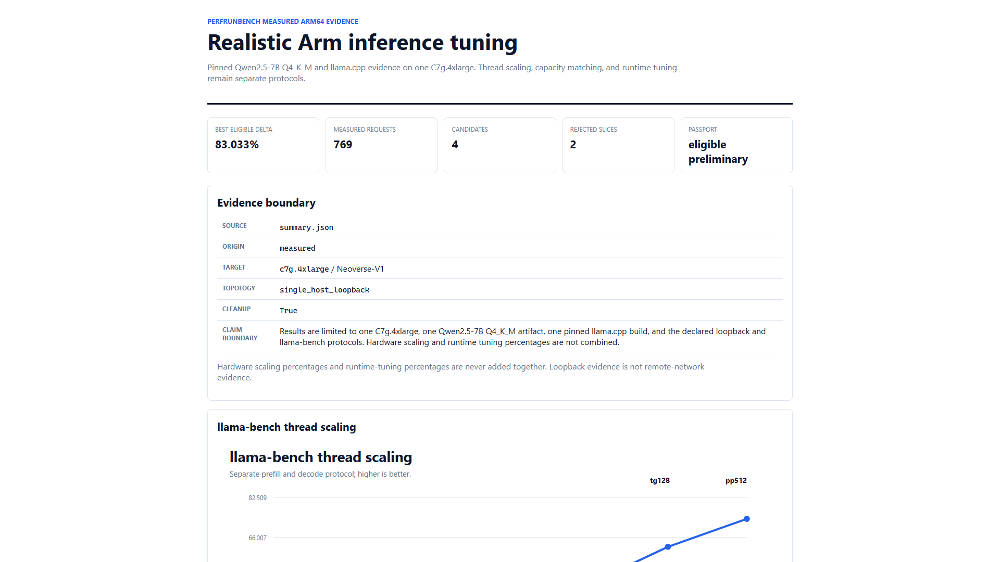
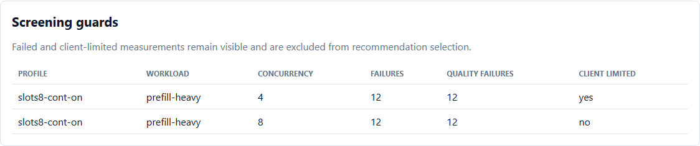

# C7g.4xlarge Realistic Arm Inference Validation

This document records a measured, sanitized Arm inference scaling and serving
validation on one AWS C7g.4xlarge. It adds a larger-target capacity experiment
without changing or replacing the validated C7g/T4g remote-client result.

The result is limited to the declared target, model, binaries, workloads,
loopback topology, and measurement protocols. Hardware scaling percentages and
runtime-tuning percentages are separate and must not be added, multiplied, or
presented as a universal speedup.

## Result

```text
status: passed
result_origin: measured
target: c7g.4xlarge / Linux aarch64 / Neoverse-V1
logical_cpus: 16
server_cpu_range: 1-15
client_cpu_range: 0
topology: single_host_loopback
server_startups: 17
measured_http_requests: 769
performance_passport_status: eligible_preliminary
cleanup_passed: true
host_restored: true
final_artifacts_checked_after_download: 278
final_artifacts_failed_after_download: 0
```

## Pinned Identity

| Item | Evidence |
| --- | --- |
| PerfRunbench source | `fab3297a62e510cf33b4cf27771707514f8f8542` |
| llama.cpp source | `b15ca938ad00aa6b3ee6c2edda7363fd02826b18` |
| Model | Qwen2.5-7B Instruct Q4_K_M |
| Model SHA-256 | `1875fb29e8c91c86615c00e92d8b4114e56bc24359adb5a8db8b36452fae4a49` |
| llama-bench SHA-256 | `6d284a756e384dc5a3cacda20ca53171d5fc937aad837c72460fcdf7a8747320` |
| llama-server SHA-256 | `3378e0dce6f44c47aca983b792335e7482ec840890772041145d374ec26114c5` |
| Runtime context | `2048` total tokens |
| Batch / ubatch | `512 / 128` |
| Flash attention | off |
| Noise band | `5%` |

The model weights and private target information are not stored in the public
repository.

## Protocols

### llama-bench Thread Scaling

- prompt phase: `pp512`
- generation phase: `tg128`
- thread counts: `1, 2, 4, 6, 8, 12, 15`
- one excluded warm-up process per thread count
- five measured repetitions per thread count
- the client/controller CPU was excluded from the server CPU range

### llama-server Runtime Screening

- baseline: one slot
- candidates: two, four, and eight slots with continuous batching
- workloads: `interactive-short`, `decode-heavy`, and `prefill-heavy`
- concurrency: `4` and `8`
- deterministic candidate order
- no retry policy
- failed and client-limited slices remained explicit failures

### Paired Confirmation

- fresh server restart for every baseline or candidate block
- deterministic randomized side order
- three baseline/candidate pairs
- 10,000-sample paired bootstrap
- throughput eligibility required at least `5%` improvement and a bootstrap
  interval excluding zero
- latency eligibility required at least `10%` p95 improvement without more
  than `5%` throughput regression
- every request required successful completion and non-empty output
- cleanup and loopback-port release were required after every block

The 7-CPU confirmation is a capacity-matched control. The 15-CPU confirmation
uses the larger instance's full server allocation. These are separate
protocols.

## llama-bench Scaling

| Threads | pp512 tok/s | pp speedup | pp efficiency | tg128 tok/s | tg speedup | tg efficiency |
| ---: | ---: | ---: | ---: | ---: | ---: | ---: |
| 1 | 6.761 | 1.000x | 100.0% | 2.759 | 1.000x | 100.0% |
| 2 | 13.641 | 2.018x | 100.9% | 5.321 | 1.929x | 96.4% |
| 4 | 26.693 | 3.948x | 98.7% | 10.465 | 3.794x | 94.8% |
| 6 | 35.502 | 5.251x | 87.5% | 14.601 | 5.293x | 88.2% |
| 8 | 46.903 | 6.938x | 86.7% | 18.447 | 6.687x | 83.6% |
| 12 | 62.153 | 9.193x | 76.6% | 25.424 | 9.216x | 76.8% |
| 15 | 73.669 | 10.897x | 72.6% | 30.089 | 10.907x | 72.7% |

The larger CPU allocation produced substantial additional throughput, while
parallel efficiency declined after the low-thread region. This is consistent
with increasing synchronization, shared-cache, and memory-traffic pressure as
more cores participate. The run did not collect hardware memory-controller
counters, so memory bandwidth saturation is a plausible explanation rather
than a verified causal claim.

## Serving Paired Results

All values below are medians from three fresh paired blocks. Baseline and
candidate use the same target, model, binary, workload, concurrency, CPU
allocation, and request protocol within each row.

| Protocol | Workload | Baseline output tok/s | `slots4-cont-on` output tok/s | Delta | Baseline p95 TTFT | Candidate p95 TTFT | TTFT reduction | Eligible |
| --- | --- | ---: | ---: | ---: | ---: | ---: | ---: | --- |
| 7-CPU capacity match, c4 | `interactive-short` | 14.297 | 26.168 | +83.033% | 4628.442 ms | 1305.623 ms | 71.791% | yes |
| 15-CPU full capacity, c8 | `decode-heavy` | 25.779 | 46.488 | +80.331% | 15816.690 ms | 5103.117 ms | 67.736% | yes |
| 15-CPU full capacity, c8 | `interactive-short` | 25.600 | 43.712 | +70.749% | 5978.608 ms | 2454.209 ms | 58.950% | yes |
| 15-CPU full capacity, c8 | `prefill-heavy` | 19.734 | 15.585 | -21.025% | 10106.897 ms | 21192.544 ms | -109.684% | no |

The eligible full-capacity recommendation is intentionally workload-scoped:

```text
profile: slots4-cont-on
concurrency: 8
eligible_workloads:
  - decode-heavy
  - interactive-short
prefill-heavy: not eligible
```

The likely mechanism is that four parallel slots and continuous batching keep
the 15 server CPUs occupied across multiple independent decode streams. One
slot leaves concurrency queued behind a single generation stream. The
long-prefill result shows the limit of that strategy: parallel prefill creates
contention and a large TTFT regression, so PerfRunbench excludes that workload
from the recommendation.

## Guard Evidence

The run preserved negative evidence instead of manufacturing a recommendation:

- concurrency 4 had no candidate valid across all screening workloads, so the
  full-capacity c4 confirmation was skipped;
- the eight-slot candidate allocated `256` context tokens per slot, while the
  long-prefill request required `412` tokens;
- both eight-slot long-prefill screening slices recorded twelve HTTP 400
  failures and twelve quality-guard failures;
- full-capacity c8 `prefill-heavy` regressed by `21.025%` and was not eligible;
- no client-limited confirmation was converted into a performance result;
- all eligible paired bootstrap intervals excluded zero;
- all final request, quality, cleanup, and artifact guards passed.

This is the expected guarded behavior: the final recommendation covers only
the workloads that passed the declared protocol.

## Artifact Validation

The remote run wrote raw command, server, request, resource, identity,
measurement, recommendation, Passport, and cleanup evidence.

Validation sequence:

1. The benchmark runner validated its structured manifest.
2. The wrapper closed stdout and stderr, rebuilt the final manifest, and
   revalidated `278` artifacts with zero failures.
3. The complete run archive was downloaded.
4. The downloaded archive SHA-256 matched the remote archive:
   `bf83288424d03176609269c26aea1b5d934e357087549cd21645a31dab3df333`.
5. A controller-side independent validator recomputed path containment, size,
   and SHA-256 for all `278` manifest entries with zero failures.
6. No llama-bench process, llama-server process, listener, or active benchmark
   port remained.

## Reusable Visual Evidence

The sanitized report contains no target address, SSH path, credential, local
model path, or private configuration:



```text
docs/results/c7g4xlarge-realistic/arm_inference_report.html
docs/results/c7g4xlarge-realistic/arm_inference_summary.json
docs/results/c7g4xlarge-realistic/thread_scaling.csv
docs/results/c7g4xlarge-realistic/serving_comparisons.csv
docs/results/c7g4xlarge-realistic/charts/
```

The report also preserves the screening outcome that rejected unsupported or
regressing slices:



Regenerate the report from a preserved measured summary:

```bash
autotuneai report-arm-inference \
  --input <measured-summary.json> \
  --output-dir <report-directory>
```

## Claim Boundary

Supported wording:

> On the tested C7g.4xlarge, pinned Qwen2.5-7B Q4_K_M model and llama.cpp
> build, the separate pp512/tg128 protocol scaled from one to fifteen threads
> by about 10.9x. Under the full-capacity loopback concurrency-8 protocol,
> slots4-cont-on improved eligible interactive and decode throughput by
> 70.749% to 80.331%, while the prefill-heavy workload regressed and was
> excluded.

Unsupported wording:

- a universal 10.9x Arm speedup;
- a direct C7g.2xlarge versus C7g.4xlarge performance ratio;
- an 80% improvement for every workload;
- a remote-network result from this loopback run;
- a compiler, kernel, page-size, allocator, or network-tuning improvement;
- any sum of hardware-scaling and runtime-tuning percentages.

## Limitations

- one C7g.4xlarge target;
- one Qwen2.5-7B Q4_K_M model;
- one pinned fresh native llama.cpp build;
- one loopback client on a reserved CPU;
- no independent remote load-generator host;
- no energy or memory-controller performance counters;
- three paired blocks per confirmed comparison;
- no claim about another model, instance family, cloud, or production traffic
  distribution.
