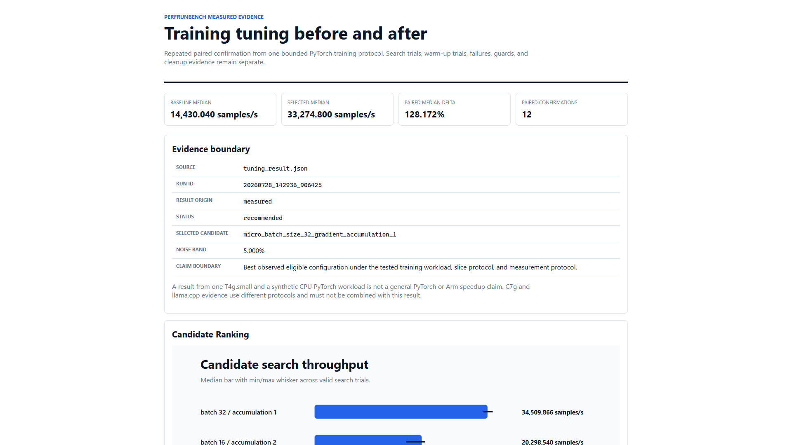
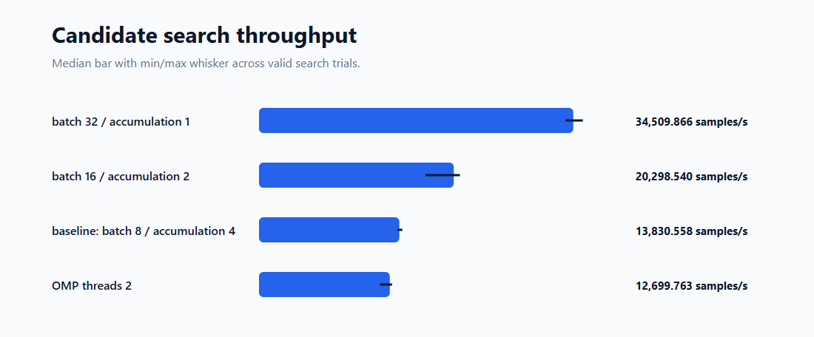
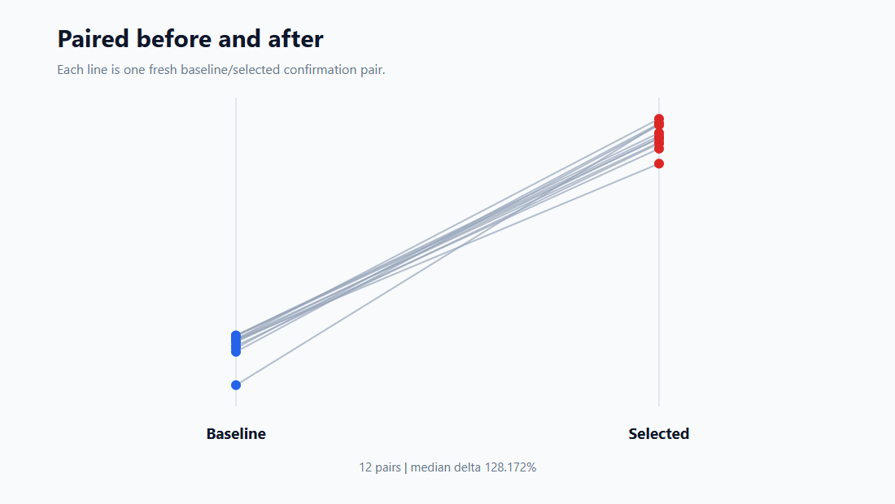
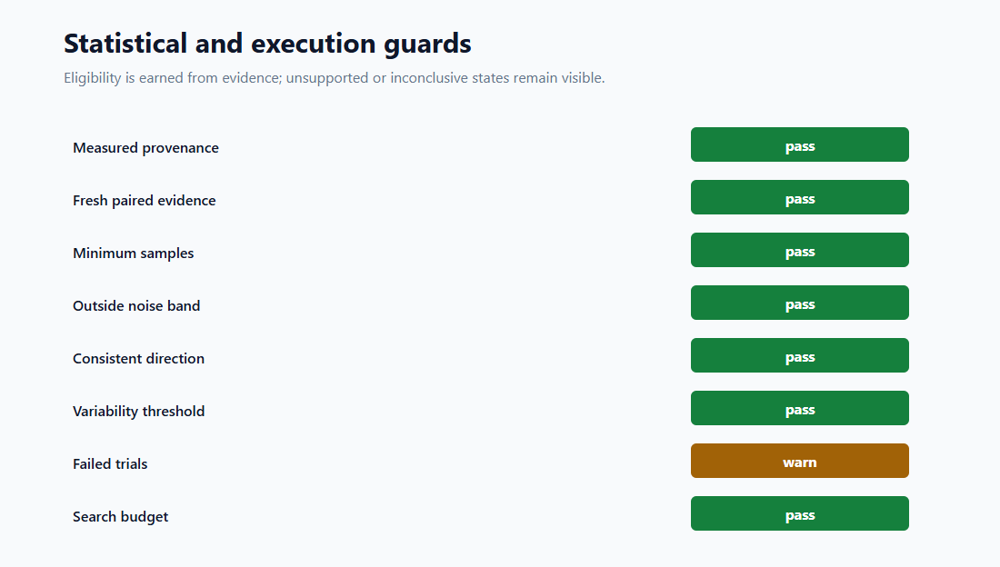
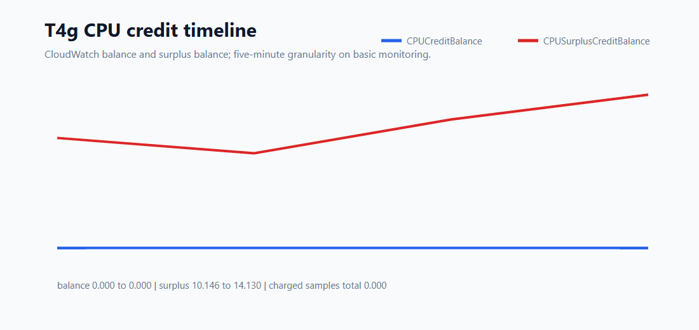

# T4g Training Visual Evidence

## Scope

This document records a clean, repeated, measured validation of the public
PerfRunbench `pytorch-training` adapter on one AWS T4g.small. The workload uses
CPU-only PyTorch and generated synthetic tensors. It is guard, workflow, and
protocol-specific optimization evidence, not a production training benchmark
or a general PyTorch speedup claim.

The clean run used source commit:

```text
43781a0dcafa58c24778ad310920a5c2c6196839
```

No model or dataset was downloaded. No system-scoped tuning, swap, CUDA wheel,
or instance resize was used.



## Target And Runtime

```text
target: AWS T4g.small
architecture: aarch64
cpu: Neoverse-N1
logical_cpus: 2
memory_total: approximately 1.8 GiB
swap: disabled
root_filesystem: ext4
python: 3.12.3
torch: 2.13.0+cpu
torch_cuda_available: false
```

The repository checkout was clean and matched the controller commit before
execution. The official PyTorch CPU wheel index supplied the Arm64 wheel.

## Measurement Protocol

```text
world_size: 1
effective_batch_size: 32
warmup_runs: 1
warmup_included_in_statistics: false
measured_steps_per_trial: 5000
search_runs_per_candidate: 4
paired_confirmation_count: 12
per_slice_timeout_seconds: 60
total_tuning_budget_minutes: 30
noise_band_percent: 5
selected_variability_limit_percent: 20
candidate_count_including_baseline: 5
```

Every eligible candidate preserved the effective batch size. Candidate order
was deterministic and bounded; PerfRunbench did not run a Cartesian product.

## Candidate Search



| Candidate | Search median | Result |
| --- | ---: | --- |
| batch 32 / accumulation 1 | `34,509.866 samples/s` | selected |
| batch 16 / accumulation 2 | `20,298.540 samples/s` | valid |
| baseline: batch 8 / accumulation 4 | `13,830.558 samples/s` | valid |
| OMP threads 2 | `12,699.763 samples/s` | valid |
| DataLoader workers 1 | no metric | `4/4` trials stalled |

The DataLoader worker candidate reached only 124 of 5,000 required steps
before each timeout. All four failures remained explicit failed trials. They
were not converted to zero and did not enter the recommendation.

## Paired Confirmation



| Metric | Baseline | Selected |
| --- | ---: | ---: |
| confirmation samples | `12` | `12` |
| median throughput | `14,430.039978 samples/s` | `33,274.800277 samples/s` |
| min throughput | `10,315.534369 samples/s` | `30,814.768200 samples/s` |
| p95 throughput | `14,909.962250 samples/s` | `34,723.376991 samples/s` |
| max throughput | `14,914.619018 samples/s` | `34,960.883742 samples/s` |
| median step time | `2.217617 ms` | `0.961696 ms` |

```text
ratio_of_medians_improvement_percent: 130.593958
median_of_paired_improvements_percent: 128.172176
minimum_paired_improvement_percent: 112.887055
selected_variability_percent: 3.360982
classification: improved
status: recommended
```

Ratio of medians and median of per-pair deltas are separate statistics and are
reported separately. All 12 pairs favored the selected configuration. The
full distributions remain available in
`t4g-training-visual/paired_confirmation.csv` and
`t4g-training-visual/training_summary.json`.

## Guards And Reuse



```text
measured provenance: passed
minimum valid samples: passed
paired baseline evidence: passed
outside 5 percent noise band: passed
consistent confirmation direction: passed
selected variability threshold: passed
search budget: completed
failed trials preserved: warning
```

The cached recommendation was exercised after the clean tuning run:

```text
first run --auto: cache_hit, newly_tuned=false, completed
second run --auto: cache_hit, newly_tuned=false, completed
run --best: newly_tuned=false, completed
cache state: soft_drift
```

The soft drift came from available-memory changes on the constrained host. It
was not a hard CPU or architecture mismatch. A separate 0.001-minute budget
test returned `inconclusive / time_budget_exhausted`, created no cache entry,
and terminated cleanly.

All process-scoped apply lock and lease records ended in `rolled_back`. No
training process, controller process, unexpected listener, or active lease
remained.

## CPU Credits And Cost Boundary



The clean run began after the T4g CPU credit balance reached zero. CloudWatch
basic-monitoring samples covered the entire clean measurement:

```text
CPUCreditBalance: 0 at every clean-run sample
CPUSurplusCreditBalance: approximately 8.732 to 14.130 credits
CPUSurplusCreditsCharged: 0 in the captured samples
```

The clean run therefore compares candidates under the same T4g Unlimited
surplus state rather than mixing a credited baseline with a throttled
candidate. The observed surplus-balance increase was approximately 5.398 CPU
credits. At the execution-time public T4g surplus rate, its worst-case
incremental charge estimate was approximately USD 0.0036 before account
credits. CloudWatch billing metrics and Cost Explorer can lag, so this is an
estimate rather than a final invoice.

T4g is burstable. These values must not be compared directly with C7g results
or presented as steady-state server throughput.

## Evidence Integrity

Two preliminary runs were excluded after review found that a failed controller
transport had left one remote process running while a second run started.
Their artifacts remain preserved, but neither run contributes to this
document, the charts, or the recommendation above.

The accepted clean run is:

```text
run_id: 20260728_142936_906425
recommendation_bundle_id: f5cbb3070fd36e78f8ca0314
result_origin: measured
artifact_manifest_validation: passed
remote_archive_artifact_count: 574
remote_archive_sha256: 2fb804075fc94f2b9f971b7fe4e6f952110d1c23845d51cb5b17899af0dbcf09
downloaded_archive_sha256_match: true
downloaded_manifest_artifacts_checked: 574
downloaded_manifest_issues: 0
```

The public HTML, CSV, JSON, SVG, and PNG views contain no private connection
details or local absolute paths. Raw process and host evidence remains in the
private evidence archive.

## Reproduce The Visuals

Given a preserved measured result and optional normalized CloudWatch data:

```bash
autotuneai report-training \
  --input .autotuneai/runs/<run-id>/pytorch_training/tuning_result.json \
  --output-dir results/reports/t4g-training \
  --cloudwatch cloudwatch-normalized.json
```

Allowed claim wording:

> Best observed eligible configuration under the tested T4g target, synthetic
> CPU PyTorch workload, slice protocol, and measurement protocol.
