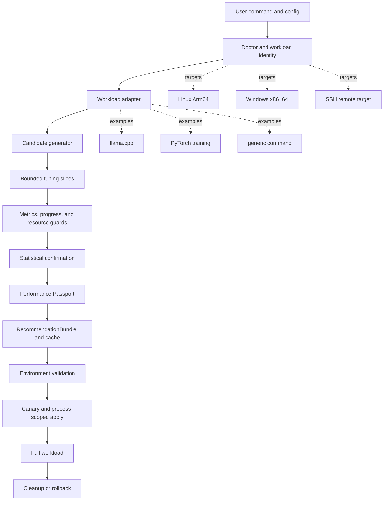

# PerfRunbench Architecture Diagram

This diagram is for Devpost, the README narrative, and the demo video. It
covers the default PerfRunbench product workflow.

## Mermaid Source

## Generated Assets

- `docs/submission/assets/perfrunbench_architecture.svg`
- `docs/submission/assets/perfrunbench_architecture.png`

The generated assets use the same flow as the Mermaid source and are sized for
16:9 demo video capture and Devpost display.
